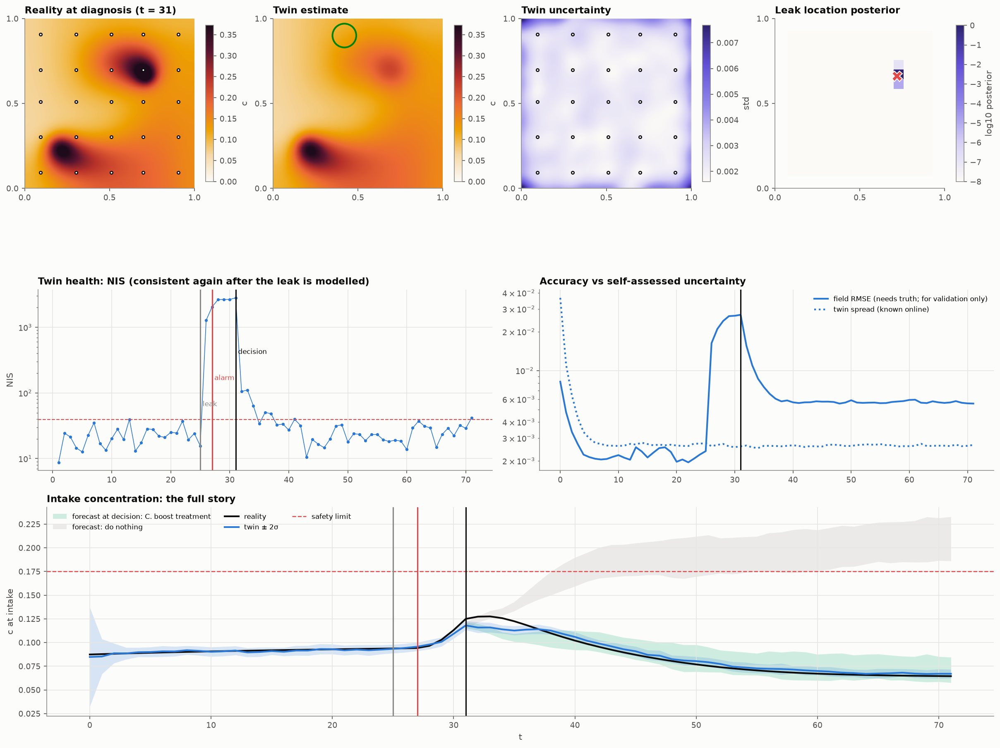

# Digital Twins of Spatio-Temporal Fields: 1D → 2D, Beginner → Expert

A hands-on course in 13 executed Jupyter notebooks: six chapters of course, then a seven-chapter
project on real data. In the course you build digital twins of physical fields:
a heated rod (1D) and a stirred contaminated tank (2D). You start from a 10-line finite-difference
solver and finish with a twin that detects a hidden leak, locates it, forecasts what-if scenarios
and recommends an action.



## Learning path
### Part I · The course
Six chapters. Each one teaches step by step: the intuition, the math, a small piece of code, and a
check of what you should see. Along the way there are "predict" questions with hidden answers, a
glossary, a quiz and exercises.

| # | Chapter | Level | Dim | You learn |
|---|---|---|---|---|
| 1 | `01_foundations_physics_and_sensors` | Beginner | 1D | what a twin is, the heat equation derived from energy bookkeeping, finite differences with a convergence study, stability (amplification factor), Crank-Nicolson, the observation operator H, noise, interpolation limits, open-loop drift, and how wrong parameters and wrong inputs can cancel |
| 2 | `02_calibration_and_kalman_1d` | Intermediate | 1D | least squares as maximum likelihood, Gauss-Newton by hand, loss landscapes, identifiability, error bars, sensor placement; the Kalman filter from a single number up to a whole field, state augmentation, NIS, tuning |
| 3 | `03_2d_fields_and_enkf` | Advanced | 2D | flattening and the 5-point Laplacian, upwind advection, Péclet number, mass balance; an EnKF toy example, then joint state-parameter estimation, inflation, localization |
| 4 | `04_reduced_order_models` | Advanced | 2D | the SVD on the rod, POD, DMD, operator inference, QR sensor placement, a reduced Kalman filter |
| 5 | `05_pinns_1d_and_2d` | Expert | 1D/2D | autograd, a one-minute inverse PINN, Burgers forward and inverse, spectral bias, the 2D PINN twin (κ, velocity, back-tracking the release) |
| 6 | `06_capstone_end_to_end_twin` | Expert | 2D | monitor → detect (NIS) → diagnose (Green's functions + Bayes) → what-if → decide → verify |

### Part II · Applied project: a rain twin from microwave links
Builds on the FieldSense / OpenMesh / pcpn_maps work: phone-network microwave links act as
path-averaging rain sensors, and a digital twin maps the rain and forecasts it.

| # | Chapter | Data | Result |
|---|---|---|---|
| 7 | `07_rain_twin_simulated` | FieldSense simulator (known truth), 90 synthetic links | the map is as good as IDW; the 30-min forecast has correlation 0.53 vs 0.22 for the link map held still; learns the storm velocity from links alone |
| 8 | `08_rain_twin_openmrg` | OpenMRG Gothenburg: 364 links, radar, 10 held-out gauges | beats the radar at the gauges; IDW is still better for the "now" map inside the dense network; at 15–30 min the twin out-forecasts persistence in 3 of 4 storms, a tie on average |
| 9 | `09_rain_twin_improved` | same as 8 | finds why the twin lost (link quirks that last for hours) and fixes it outside the state: a hybrid map that beats IDW at the gauges in all four storms, and a link forecast that picks its own fade time and beats persistence on average at 15–60 min. Finer grids, radar as a sensor and a global growth rate did not help |

### Part III · A multi-sensor rain twin and its distilled student
Gothenburg, the whole summer of 2015: 358 links, 27 weather-station cells, the SMHI radar and 10
city gauges that are only used for scoring. Data come from FieldSense's 5-minute multi-sensor cube.

| # | Chapter | Result |
|---|---|---|
| 10 | `10_rain_twin_system` | one twin, any mix of links / stations / radar. Its best map (NRMSE 1.05 at the gauges) beats every static map without radar, and loses to FieldSense's radar merge RCP (0.99). Radar enters best in log space, or as the base of a twin of the radar's *error*. The twin learns storm motion; its spread is far too narrow |
| 11 | `11_distilling_the_twin` | knowledge distillation: a 2 ms U-Net that sees only links and stations, trained on the twin (which saw the radar). NRMSE 1.02 over three seeds: better than its teacher (1.06), than IDW of the same inputs (1.06) and than the same network trained on radar (1.63); a little steadier than one trained on the static merge (1.00 to 1.05). Its spread is about ten times too narrow |
| 12 | `12_new_york_transfer` | the same twin and student, untuned, in New York in winter (26 links, 27 stations, MRMS radar, 4 airport gauges). The ranking flips: stations beat links, the radar alone beats the links, RCP is best again (0.43). The twin with all sensors ties IDW (0.58); links only, it fails (1.43) because the gauges are 4 to 14 km from any link. Distillation does not transfer: a twin that leans on a good radar is a poor teacher for a radar-free student (0.83), and RCP is the better teacher (0.56 to 0.57) |
| 13 | `13_emilia_romagna` | the same twin in Emilia-Romagna (10 storms, about 130 links, 300 gauges 5 km apart, a radar 51 % high), hourly data, scored on FieldSense's 5-fold held-out gauges. It does not transfer: untuned, its best map (radar only, 2.02) barely beats the raw radar (2.21) and gauges or links make it worse. Two fixes (gauges observed in log space; a random walk on the radar's bias, which was frozen at its first estimate here and in ch 10 and 12) bring the full twin to 1.93, still behind gauge IDW (1.58) and FieldSense's KED (1.27) in every storm. At one step an hour, showers do not survive from step to step, and the twin is left as a weaker interpolator than kriging |

The heavy runs of Part III are cached in `cache/` (teacher labels: `python tools/teacher_labels.py [openmrg|openmesh]`).
Part III needs a FieldSense checkout with the `multisensor_nowcasting` cube built
(`FIELDSENSE_DIR`). Chapter 13 reads FieldSense's `multisensor` merging inputs and scores for
Emilia-Romagna instead, and its twin runs are cached by `python tools/italy_runs.py` (about 50 min on 4 processes).

The twin itself is the package `raintwin/`. It has a link observation operator, a log-rain EnKF
with the storm velocity in its state, IDW baselines, the hybrid map, the forecast blend and an OpenMRG loader. Chapter 7 needs a
FieldSense checkout (`FIELDSENSE_DIR`, default `~/PycharmProjects/FieldSense`). Chapters 8 and 9 need
the OpenSense OpenMRG example subset (`OPENMRG_DIR`, default `~/data/cml/openmrg/_sample_8d`).

Most chapters run in under a minute. Chapter 5 trains four PINNs and needs about 8 minutes on a
laptop CPU, and Chapter 9 about 15. The original 10-notebook version is kept in `archive/`.

## Layout

```
dtwin/                 reusable toolkit used by the notebooks
  solvers.py           Heat1D (Crank-Nicolson), exact Burgers (Cole-Hopf), AdvDiff2D (conservative FV, batched)
  sensors.py           point sensors / observation operators
  assimilation.py      Kalman filter, EnKF with inflation + localization, NIS
  rom.py               POD, DMD, QR sensor placement, gappy reconstruction
  pinn.py              MLP, autograd helpers, Adam → L-BFGS trainer
  viz.py               one visual language: palette, colormaps, space-time plots, 2D fields, animations
raintwin/              the rain twin (Part II)
  core.py              link operator, IDW, RainTwin (EnKF with motion, extra sensor sets), ResidualBlend
  openmrg.py           OpenMRG loader on the radar grid, finer grids
  cube.py              FieldSense's 5-min multi-sensor cube (links, stations, radar, gauges)
  openrainer.py        Emilia-Romagna storms from FieldSense's merging inputs, hourly, with its gauge folds
  system.py            the twin with any sensor mix, the radar-error twin, wet periods
  distill.py           student U-Net, training and prediction
cache/                 cached runs of Part III
notebooks_src/         notebook sources (percent-format .py; edit these)
notebooks/             generated, executed notebooks with all figures and animations
figures/               key figures exported by the notebooks
tools/build.py         .py → .ipynb builder and executor
```

## Run

```bash
pip install -r requirements.txt
jupyter lab notebooks/                 # notebooks ship pre-executed; just open and read
python tools/build.py                  # rebuild + re-execute all notebooks from notebooks_src/
python tools/build.py 02 03            # only some chapters
```

## Visual conventions
- **Black** = reality, **blue** = twin, **orange** = sensor data, **grey** = baselines/open loop.
- Warm sequential map = field magnitude, blue/orange diverging map = errors, violet = uncertainty.
- Dots on 2D maps are sensor locations.
